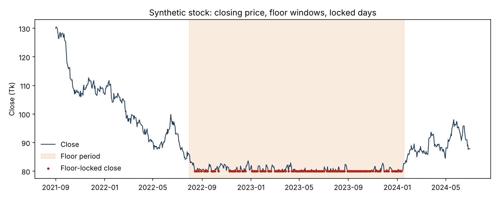

# dse-floor-freeze-detector

Data cleaning and **price-freeze (floor-lock) detection** for Dhaka Stock Exchange (DSE) daily prices.

Between 2020 and 2026 the Bangladesh Securities and Exchange Commission (BSEC) imposed regulatory **floor prices** on DSE-listed securities. Many stocks then closed at exactly the same price for weeks or months. Those frozen closes are not equilibrium prices: returns computed from them understate volatility and clip the lower tail, which biases any risk model built on top, such as regime detection or CVaR portfolio optimisation.

This repository contains the first three steps of a thesis pipeline: **clean the data, work out when a floor was in force, and flag the days on which a price was actually frozen by it.** The output is the input to the later bias-correction stages (see [Project context](#project-context)).



*Synthetic data (the demo ships no real prices). Shaded: days when a floor regime applied. Red: closes flagged as floor-locked.*

## What is in here

| Step | Module | What it does | Adds columns |
|---|---|---|---|
| 1 | `dse_floor.cleaning` | Types, de-duplication, zero-as-missing, log returns, 21-day volume z-score | `Observed_Log_Return`, `Volume_Z`, `Trading_Day_Index` |
| 2 | `dse_floor.classification` + `timeline` | Tags each (security, date) with whether a BSEC floor regime applied, using the hard-coded regulatory timeline | `Floor_Period_Flag`, `Floor_Period_Regime` |
| 3 | `dse_floor.detector` | Rule-based detector: estimates the binding floor per contiguous floor block and flags frozen closes | `Floor_Locked_Flag`, `Floor_Price` |

`Floor_Period_Flag = 1` means a floor *could* bind. `Floor_Locked_Flag = 1` means the close sits in the empirical floor region. The two differ on purpose: a stock can trade freely above its floor during a floor period.

## Install

```bash
git clone https://github.com/al-mahiro/dse-floor-freeze-detector.git
cd dse-floor-freeze-detector
pip install -e ".[dev]"      # numpy, pandas, openpyxl, matplotlib, pytest
pytest -q                    # 17 tests
```

Python 3.9 or newer.

## Quick start

Your input needs seven columns: `Trading_Code, Date, Open, High, Low, Close, Volume`, one row per security per trading day. A multi-security panel works, since everything is grouped by `Trading_Code`.

```python
from dse_floor import load_ohlcv, run_pipeline, sensitivity_grid

raw = load_ohlcv("MYSTOCK.csv")                      # or .xlsx
out, blocks = run_pipeline(raw, return_diagnostics=True)

print(out["Floor_Period_Flag"].sum(), "floor-period days")
print(out["Floor_Locked_Flag"].sum(), "floor-locked days")
print(blocks)                                        # one row per floor block
```

Or from the command line:

```bash
python -m dse_floor MYSTOCK.csv -o labelled.csv --diagnostics blocks.csv --sensitivity
```

Try it without any data: `python examples/synthetic_demo.py --plot`.

### Using one step at a time

```python
from dse_floor import clean_ohlcv, add_floor_period_flag, detect_floor_locked_prices

df = clean_ohlcv(raw)
df = add_floor_period_flag(df)
df = detect_floor_locked_prices(df, lower_q=0.35, min_support=3, tick_size=0.10)
```

## How the detector works

For each security and each contiguous run of `Floor_Period_Flag == 1` days (a *block*):

1. Convert closes to integer **ticks** (`round(close / 0.10)`), so equality tests are exact.
2. Keep the **lower tail**: ticks at or below the `lower_q` quantile (default 0.35) of the block.
3. The **floor estimate** is the most frequent tick in that tail; ties go to the lowest price. Its count is the *modal support*.
4. If support is below `min_support` (default 3) the block gets no estimate and nothing in it is flagged. A one-day block is the exception: its single close is the floor.
5. A close is **floor-locked** if `block_min <= tick <= floor`, both ends inclusive.

`Floor_Price` is a data-driven proxy for the binding price level, not a direct observation of the legal floor. See the module docstring in [`detector.py`](src/dse_floor/detector.py) for details.

### The regulatory timeline

`dse_floor.timeline.FLOOR_PERIODS` encodes the BSEC regimes using *effective trading sessions* (not announcement dates):

| Period | Regime |
|---|---|
| 19 Mar 2020 - 7 Apr 2021 | all securities |
| 8 Apr 2021 - 17 Jun 2021 | 66, then 96, securities exempted |
| 18 Jun 2021 - 30 Jul 2022 | no floor |
| 31 Jul 2022 - 21 Dec 2022 | all securities |
| 22 Dec 2022 - 1 Mar 2023 | 168 securities exempted |
| 2 Mar 2023 - 18 Jan 2024 | all securities |
| 21 Jan 2024 - 18 Mar 2024 | only 35, then 12, 9, 8, 7 securities |
| 19 Mar 2024 - 28 Aug 2024 | 6 securities |
| 29 Aug 2024 - 8 Jun 2026 | 2 securities (BEXIMCO, ISLAMIBANK) |
| from 9 Jun 2026 | no floor |

Company lists were transcribed from BSEC orders by the authors. **Re-verify them against the primary orders before relying on them** in new work. Each boundary's derivation is commented in the source.

## Data-quality notes

- **Trading calendar.** DSE trades Sunday to Thursday and was closed 26 Mar - 30 May 2020. `clean_ohlcv` *warns* when it finds Friday/Saturday rows or rows inside the closure (a sign of misaligned dates in the raw export). Removal is opt-in via `drop_weekend_rows=True` and `drop_closure_rows=True`.
- **No data included.** Raw and derived market data are not redistributed here; bring your own export (the thesis used a public Harvard Dataverse DSE dataset ending 8 April 2025).
- **Sensitivity grid.** `sensitivity_grid` reports locked-day counts over `(lower_q, min_support)`. Counts that never change can mean robustness *or* a grid that never alters the modal estimate, so read it together with the per-block diagnostics.

## Known limitations

- One floor level is estimated per block. If the legal floor was re-set *inside* a block (for example through a price-averaging reset), the second level may be mis-handled; inspect long blocks via `return_diagnostics=True`.
- Release days (the first sessions after a floor is lifted) may still be limited by the daily circuit breaker, so they can be censored too. The detector does not model this.
- The timeline ends at the June 2026 withdrawal, but the public dataset used in the thesis ends in April 2025.

## Project context

This is part of an undergraduate thesis at the Department of Industrial and Production Engineering, Bangladesh University of Engineering and Technology (BUET):

> **Mitigating Regulatory Price Freeze Bias in Regime-Aware Portfolio Optimization: A Hybrid Framework for the Dhaka Stock Exchange (DSE)**

The full pipeline is described in [`docs/PIPELINE.md`](docs/PIPELINE.md): floor detection, a one-sided **censored stochastic volatility** model that reconstructs latent returns (after Hsieh and Yang, 2009), a 3-state HMM for regimes, a heterogeneous-agent model calibrated with a genetic algorithm, XGBoost return forecasts, and a regime-aware CVaR optimiser, tested on raw versus corrected data. **Only Steps 1-3 are in this repository.** The later stages are in development and are not released yet.

## Authors and supervision

Abdullah Al Mahi and Saptaporna Dey, supervised by Dr. Nafisa Mahbub (Department of Industrial and Production Engineering, BUET).

## Citation and license

If this helps your work, cite it via [`CITATION.cff`](CITATION.cff). Released under the [MIT License](LICENSE).
